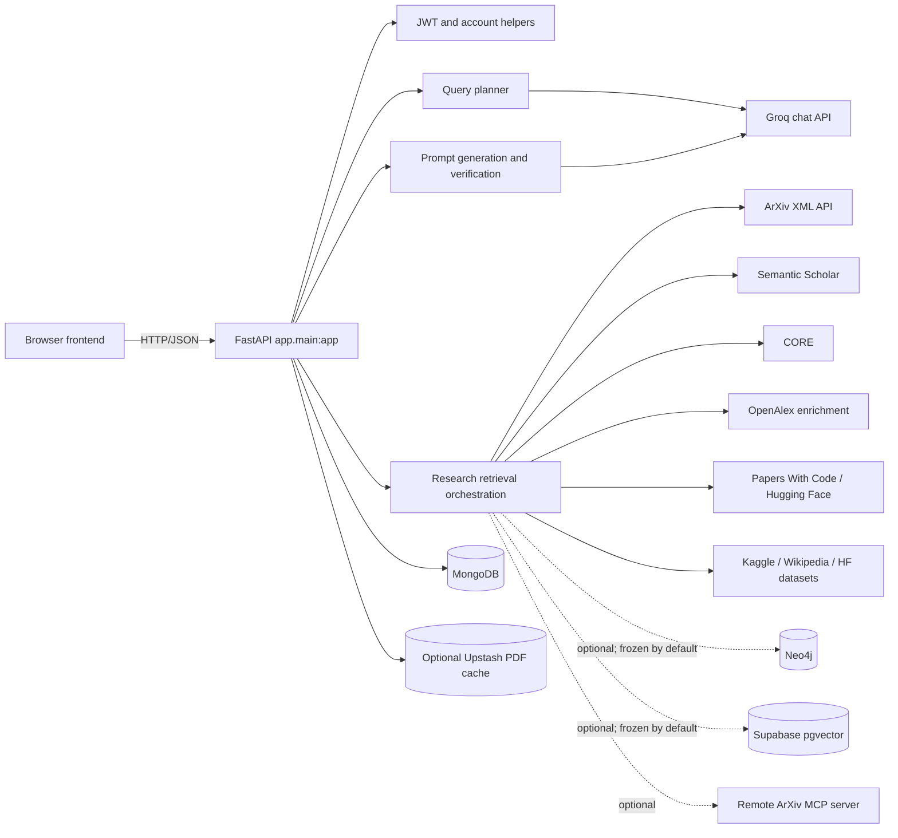

# Aether Backend Master Overview

## Purpose and business problem

Aether is a research assistant intended to help a user discover papers and
related research resources, ask questions about research topics or supplied
papers, and receive answers accompanied by source metadata. The backend
coordinates query planning, research-provider calls, optional graph/vector
retrieval, prompt construction, model inference, verification, accounts, chat
history, and document handling.

The key design goal is evidence-aware answers rather than a bare LLM response.
That is a goal enforced partly by prompts and application branching; it is not
a guarantee that every generated statement is correct.

## Runtime status: active versus present in source

| Component | Status established from source/config |
|---|---|
| FastAPI app, routes, MongoDB account/history/PDF operations | Implemented; MongoDB is initialized at startup and required for these operations |
| Groq chat completion | Used by planner, answer generation, verification, and other model paths; startup readiness checks for configured Groq HTTP client and keys |
| ArXiv XML feed | Implemented in `retrieve_arxiv_context`; fallback path used when MCP is unset, self-targeting, or unsuccessful |
| Semantic Scholar, CORE, OpenAlex, Papers With Code/Hugging Face, Kaggle, Wikipedia | Connectors are implemented; each may be skipped, rate-limited, or fail based on credentials/provider availability |
| Supabase vector search and Neo4j retrieval | Code exists but database retrieval is paused by default with `FREEZE_RETRIEVAL=true`; retrieval functions return empty data while frozen |
| Embeddings during frozen mode | Normal retrieval embedding calls return a 768-element zero vector while frozen; PDF-specific embedding calls deliberately pass `bypass_freeze=True` |
| Credit enforcement | Disabled by default (`CREDIT_SYSTEM_ENABLED=false`); Pro-only checks and request rate limits remain in code |
| Email verification | Disabled by default (`REQUIRE_EMAIL_VERIFICATION=false`); verification and reset flows remain implemented |
| ArXiv MCP client/server | Optional client path; separate server application and Dockerfile exist. A remote deployment is not confirmed by source |
| `knowledge_graph.api` | Separate legacy/standalone graph service on port 8001; not registered in the main FastAPI app |
| Production deployment | Vercel and Render deployment instructions/configuration exist; a production deployment is not verified here |

## Technology stack

| Concern | Implementation |
|---|---|
| HTTP API | FastAPI, Uvicorn, Pydantic v2 |
| Async HTTP | HTTPX |
| Accounts, history, PDFs, payment records | PyMongo `MongoClient` against configured MongoDB |
| Graph retrieval (paused by default) | Neo4j Python driver and Cypher |
| Vector retrieval (paused by default) | Supabase Python client and RPC calls |
| LLM | Groq OpenAI-compatible chat-completions HTTP endpoint |
| Embeddings | `BAAI/bge-base-en`, local SentenceTransformer or Hugging Face Inference API |
| PDF processing | PyMuPDF (`fitz`), NumPy cosine similarity |
| Optional cache | Upstash Redis for PDF chunk/embedding cache; in-memory fallback |
| Frontend | Static HTML, CSS, vanilla JavaScript; mounted by FastAPI |
| Optional independent protocol service | FastMCP ArXiv server using HTTP/SSE |

Pinned and lower-bound dependencies are recorded in
[`pyproject.toml`](../../pyproject.toml) and the requirements files.

## High-level component diagram



## Repository map

| Path | Responsibility |
|---|---|
| `app/main.py`, `app/_server.py` | Main FastAPI construction, lifespan, router wiring, local server |
| `app/routes/` | Auth/history/payments, chat, graph, health, media, research endpoints |
| `app/models/` | Pydantic request schemas and `QueryPlan` dataclass |
| `app/core/` | Planner, retrieval, Neo4j queries, PDF handling, prompts, verification, exceptions |
| `app/clients/` | Groq/embedding client and service/database pool/cache helpers |
| `app/sources/` | External research/data-source connectors and MCP client |
| `app/utils/` | Auth, email, conversation management, credits/rate limiting, links/dataset helpers |
| `api/index.py` | Vercel Python entry point importing the main ASGI app |
| `arxiv-mcp-server/` | Independent FastMCP ArXiv tool server |
| `knowledge_graph/` | Separate standalone Neo4j API, sample graph seeding, and traversal implementation |
| `ingestion/` | Offline CSV ingestion/upload scripts for Supabase; not request-path code |
| `scripts/` | Environment validation and evaluation/development scripts |
| `tests/` | Unit, mocked integration, connectivity, and manual/provider tests |

## Startup lifecycle

1. `app._server` imports `app.main:app`, then starts Uvicorn using `PORT`,
   `ENV`, and `WORKERS`.
2. Importing `app.config` loads `.env.local` with override, then `.env` without
   override; sets Hugging Face offline mode; and configures logging.
3. Importing `app.clients.groq` attempts to load the local embedding model if
   SentenceTransformer is installed. On failure it logs a fallback to the HF
   API; this happens at import time.
4. `app.main.lifespan` calls `pool.init()`.
5. When retrieval is frozen, Supabase and Neo4j initialization is skipped.
   MongoDB ping and index creation still run. An HTTPX client is then created
   for Groq.
6. `pool._ready` is set from presence of the Groq HTTP client and configured
   Groq key list; it is not a full check of MongoDB or provider health.
7. Shutdown closes the HTTP client, Neo4j driver if created, and Mongo client.

## Main research request flow

```text
POST /api/research
 -> ResearchRequest validation
 -> research() timeout wrapper
 -> _research_impl(): readiness, IP rate limit, optional user context/plan, credit helper
 -> special PDF/Wikipedia routes or plan_query()
 -> route-specific graph/vector/external retrieval (graph/vector return empty while frozen)
 -> paper relevance filtering, ranking, enrichment, dataset/repository collection
 -> prompt builder -> groq_chat()
 -> optional requirements coverage check and answer verification
 -> link cleanup and response assembly
```

For request-level detail and branches, see
[02. API ENDPOINT DOCUMENTATION](./02.%20API%20ENDPOINT%20DOCUMENTATION.md) and
[03. BUSINESS LOGIC AND EXECUTION FLOWS](./03.%20BUSINESS%20LOGIC%20AND%20EXECUTION%20FLOWS.md).

## Important source/README discrepancies

- `QueryPlan` and planner validation include **10** route values, including
  `context_only`; some README text calls these “9 routes”.
- The current checked-in config defaults to model ID `openai/gpt-oss-120b`,
  while the README’s tech stack describes a Llama model. Runtime env values
  may override either default; inspect the active deployment environment to
  know which model is actually configured.
- The README describes detailed Vercel path routing, but checked-in
  `vercel.json` sends all paths to `api/index.py`.
- The README describes active graph/vector architecture at length, while the
  default retrieval flag freezes both systems.
- Database table/collection counts mentioned in prose are not validated by
  the application source. This guide reports only fields and operations
  directly visible in code.

## What cannot be inferred

The full production database schema and data, provider account quotas,
deployed Vercel/Render URLs and runtime settings, measured quality/latency
benchmarks, project development timeline, and individual contribution history
are **not verified from source code**.
