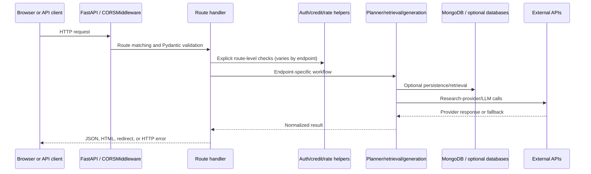

# Backend Architecture

## Application entry point and composition

The primary ASGI object is `app` in [`app/main.py`](../../app/main.py#L38).
It creates a FastAPI application, installs CORS middleware, includes routers,
and mounts static frontend files. [`app/_server.py`](../../app/_server.py)
is the local Uvicorn launcher. [`api/index.py`](../../api/index.py) adjusts
`sys.path` and imports the same `app` for Vercel.

`app.main.lifespan()` calls `pool.init()` before serving and `pool.close()` at
shutdown. There is no general FastAPI dependency-injection layer for database
clients: route modules import the module-level `pool`, and helpers import
configuration and clients directly.

## Router registration

The main app includes health, auth, payment, history, graph, research, chat,
and media routers. Some routers define their full path in decorators (e.g.
`/api/research`); others use prefixes such as `/api/auth`, `/api/graph`, or
`/api`. Endpoint membership and auth are listed in the API document.

The `knowledge_graph.api:app` object is an independent FastAPI app. It is not
included in `app.main:app`; its similarly named graph endpoints do not
automatically become routes of the main service.

## Middleware, authentication, and request lifecycle

The main app installs `CORSMiddleware` with `ALLOWED_ORIGINS`, all methods and
headers, and `allow_credentials=False`. There is no globally installed JWT
authentication middleware. Routes opt into authentication by calling
`get_token_from_request()` / `get_authenticated_user()`. Research, chat,
media, and most graph endpoints accept requests without a JWT, while attaching
user state or plan behavior if a valid bearer token is supplied.

The API rate limiter is an application helper, not ASGI middleware. Routes
explicitly call `check_rate_limit()`; coverage is therefore endpoint-specific.
It stores timestamps in process memory keyed by client IP.

## Main research orchestration

`POST /api/research` uses `research()` as a timeout wrapper around
`_research_impl()` in [`app/routes/research.py`](../../app/routes/research.py#L160).
The implementation:

1. Asserts service readiness, checks IP rate limiting, resolves optional user
   context/plan, and calls the credit helper (a no-op by default).
2. Detects PDF/arXiv URLs and optional Wikipedia mode prefixes.
3. Handles simple PDF summaries, uploaded-PDF QA, and direct Wikipedia lookup
   before the general planner path.
4. Uses `plan_query()` and switches on route; entity, structured, title, and
   chat routes have direct branches.
5. For general research, retrieves graph and vector results plus external
   papers in parallel. Frozen graph/vector operations return empty values.
6. Merges and filters candidates, enriches metadata, assembles datasets and
   code links, constructs a route-specific prompt, and calls Groq.
7. Optionally checks required answer coverage, verifies against source
   context, resolves links, and returns a JSON result.

## Internal module boundaries

| Layer | Modules | Main responsibility |
|---|---|---|
| Route/API | `app/routes/*.py` | HTTP validation, status codes, workflow sequencing, response shape |
| Request data | `app/models/*.py` | Pydantic request validation; `QueryPlan` data carrier |
| Orchestration | `app/core/planner.py`, route `_impl` functions | Plan, choose route, coordinate calls |
| Retrieval | `app/core/retrieval.py`, `app/core/graph.py`, `app/sources/*` | Search and normalize sources |
| Generation | `app/core/generation.py`, `app/clients/groq.py` | Prompt construction, chat-completions call, verification |
| Persistence/clients | `app/clients/pool.py` | Shared database handles, cache, readiness, token helpers |
| Cross-cutting helpers | `app/utils/*` | Auth, email, credits, rate limits, conversation, links |

These are Python module boundaries inside one application process, not
independently deployed services. The MCP server is a separate deployable
process; the legacy graph API is also separately runnable.

## Concurrency and error propagation

Async HTTP calls generally use HTTPX. Blocking MongoDB, Neo4j, local model, and
PDF parsing operations are moved to worker threads with `asyncio.to_thread`.
The code uses `asyncio.gather()` for provider fan-out and sometimes
`asyncio.wait_for()` for endpoint or per-provider time limits. Failure policy
is per call site: some branches return empty lists, while core generation
errors become HTTP 502 and outer timeouts become HTTP 504. See
[10. ASYNC PROGRAMMING AND PERFORMANCE](./10.%20ASYNC%20PROGRAMMING%20AND%20PERFORMANCE.md).

## Architecture decisions and trade-offs visible in source

- **Modular monolith:** one FastAPI process owns most backend features. This
  keeps local development simple but couples release and scaling of routes.
- **Provider normalization:** connectors map provider-specific records into
  dictionaries consumed by shared prompt and UI code.
- **Feature-flagged retrieval:** freezing avoids startup dependency on the
  graph/vector databases but also means those stores do not contribute
  research evidence in the default configuration.
- **In-memory shared state:** caches and rate limiting are process-local;
  they do not coordinate across Uvicorn workers or serverless instances.
- **Graceful degradation:** provider search frequently returns `[]` or `None`
  on errors. This improves availability but can hide provider-level failure
  from the client unless warnings/logs are consulted.
- **No outbox/message broker:** no durable asynchronous job queue is present
  in the inspected application flow.
