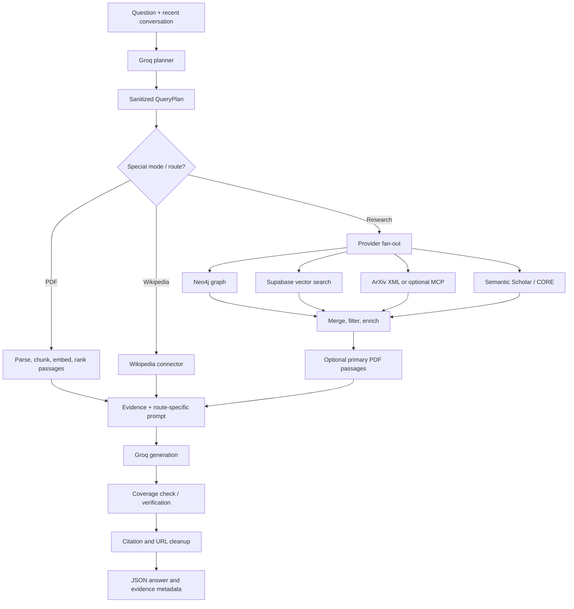

# AI and RAG Pipeline

## Pipeline overview

The main research path composes several kinds of evidence before asking the
LLM to synthesize an answer:

1. **Plan:** Groq returns a structured `QueryPlan` from the user's query and
   conversation context.
2. **Retrieve:** Graph, vector, arXiv, Semantic Scholar, CORE, and optional
   supplementary providers are queried according to endpoint/route.
3. **Normalize and filter:** Connector records become common dictionaries;
   papers receive query-relevance scoring and ranking.
4. **Enrich:** Citation/TLDR/code/dataset metadata may be fetched from
   providers.
5. **Synthesize:** A route/depth-specific prompt includes papers, chunks,
   graph relations, chronology, and source labels.
6. **Check:** High-depth requests can get a coverage check; ordinary requests
   can get a second-pass LLM verification.
7. **Resolve citations:** Citation tags and URLs are cleaned against returned
   evidence.

## Retrieval layers

### Supabase vector retrieval (paused by default)

`vector_search()` calls the Supabase RPC `match_paper_chunks` with a query
embedding, similarity threshold, result count, and optional filter IDs.
`hybrid_search()` calls RPC `hybrid_search` with query text and embedding.
`run_vector_pipeline()` requests up to `top_k * 2` raw chunks, applies
relevance filtering, merges adjacent chunks from the same paper, applies MMR,
and truncates to `top_k`.

When `FREEZE_RETRIEVAL` is true, the vector functions short-circuit and return
empty lists. `create_embedding()` also returns an all-zero 768-element vector
unless called with `bypass_freeze=True`. This makes normal vector retrieval
inactive even though the methods are implemented.

The actual Supabase table definitions, RPC SQL, embedding column/index
configuration, and live contents are not present in the inspected repository.
The ingest scripts suggest `papers` and `paper_chunks` tables, but that is not
proof that the remote schema matches their assumptions.

### Chunk processing

- `filter_relevant_chunks()` applies similarity/relevance thresholds.
- `merge_adjacent_chunks()` groups by paper ID and combines nearby chunk
  indices, preserving source order.
- `mmr_rerank()` balances query relevance against similarity to already
  selected chunks using `MMR_LAMBDA` (default 0.6).
- The vector result RPC and embedding coordinate system must match for useful
  scores; schema and embedding model provenance are not validated at runtime.

### Graph retrieval (paused by default)

`app/core/graph.py` uses Neo4j publication/author/topic/venue nodes and
relations such as `CITES`, `WRITTEN_BY`, `PUBLISHED_IN`, `HAS_TOPIC`, and
`SIMILAR_TO`. Search/traversal methods return empty values when retrieval is
frozen. The standalone `knowledge_graph/` API contains separate, more
feature-rich query code and sample data but is not mounted in the main app.

### Live academic search

`retrieve_arxiv_context()` may call the optional ArXiv MCP server when
`ARXIV_MCP_URL` is configured and not identified as a local self-target. If
MCP returns no usable papers or errors, it falls back to the public ArXiv XML
API. It parses title, abstract, authors, year, ArXiv/PDF URL, DOI, journal
reference, comment, and categories.

Other sources are connector- and endpoint-specific. See
[08. MCP AND EXTERNAL INTEGRATIONS](./08.%20MCP%20AND%20EXTERNAL%20INTEGRATIONS.md).

## Paper ranking

`paper_relevance_score()` tokenizes query/title/abstract/TLDR/description,
normalizes a few variants (including `GraphRAG` and `GNN`), and rejects a
paper unless at least one/two query terms match depending on query length. It
weights title overlap more than abstract overlap and caps the score at 1.
Research orchestration then combines relevance order with citation-count
logarithm and limited recency bonus, sorts, and keeps up to eight papers for
prompt synthesis.

This scoring is a heuristic, not a learned evaluator or calibrated probability.
Provider ranking is also not a guarantee of academic quality or exhaustive
coverage.

## Prompt construction and generation

`grounded_prompt()` adds:

- Graph relationships and graph context.
- ArXiv and Semantic Scholar paper contexts.
- Papers With Code metadata and a cross-source chronological summary.
- Optional primary-source excerpts extracted from full PDFs.
- Retrieved chunks labelled with numeric citation tags.
- Query-depth and answer-requirement instructions.

Separate prompt builders exist for comparison, survey, timeline, conceptual
explanation, document summary, and graph contexts. Route-specific prompts
define different structure/word-count/citation guidance. A system prompt
instructs the model not to invent source URLs and to label general knowledge
separately. Prompt instructions reduce risk but do not prove every generated
claim is grounded.

`groq_chat()` calls the Groq OpenAI-compatible
`/openai/v1/chat/completions` endpoint. Temperature-zero outputs can be cached.
The wrapper rotates configured keys, retries rate-limit/HTTP failures, trims
oversized prompts, and raises `LLMError` after failure. Model ID and token
limits are selected by each route.

## Primary-paper full-text retrieval

For `depth == "high"` and `rag`/`compare`, the route identifies papers whose
titles contain a planner entity marked `primary_source_required`. It fetches
at most three PDFs, extracts text, scores overlapping text windows against
planner search tiers/metrics, and adds up to six matched passages per paper.
This is keyword-overlap extraction, not BM25 library scoring despite the
helper's BM25-inspired description. A PDF failure simply yields no primary
passages.

## Verification and citation cleanup

`verify_answer()` extracts some years, numbers, author-like strings, and
quoted phrases, then compares them to source text. It also asks a second Groq
call to flag unsupported claims and return confidence/verdict. This is an
LLM-assisted check, not formal entailment or a guarantee.

`apply_verification()` appends a warning for `PARTIAL`/`FAIL` or `SKIPPED`.
The answer's citation tags are subsequently converted to links where the
evidence has known URLs; placeholder URLs are removed and configured secret
patterns are masked.

## Important frozen-mode implications

- Academic external APIs can still provide title/abstract metadata; freezing
  specifically disables the app's Supabase/Neo4j database retrieval and
  normal embedding generation.
- The default research no-evidence branch can return a refusal if external
  providers also return nothing.
- PDF flows deliberately bypass the embedding freeze for local document
  search; therefore “retrieval frozen” does not mean all document analysis is
  disabled.
- Knowledge-graph, vector database, and external-source results are distinct
  evidence types and should not be conflated in UI or interview explanations.
